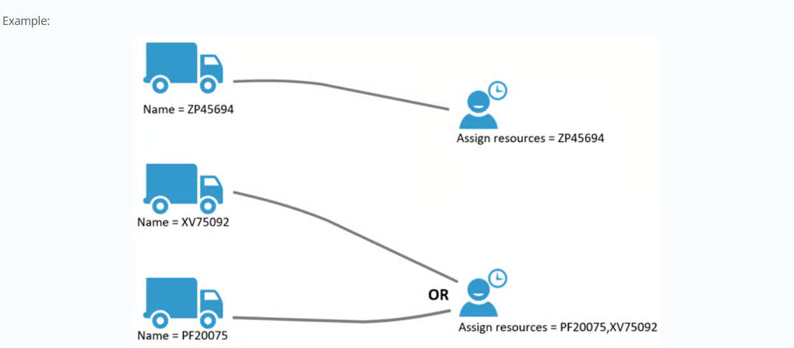

# Assegna risorse

Questa vincolo ti consente di **specificare quali risorse sono autorizzate a visitare un sito**. I valori inseriti devono **corrispondere ai valori Nome** assegnati a ciascuna risorsa.

**Formato:** Carattere, elencato come **valori separati da virgola** se si specificano più risorse.

**Esempio:**

* Se sono autorizzate a visitare un sito solo Risorsa A e Risorsa B, inserire: Risorsa A, Risorsa B

<figure><figcaption></figcaption></figure>
